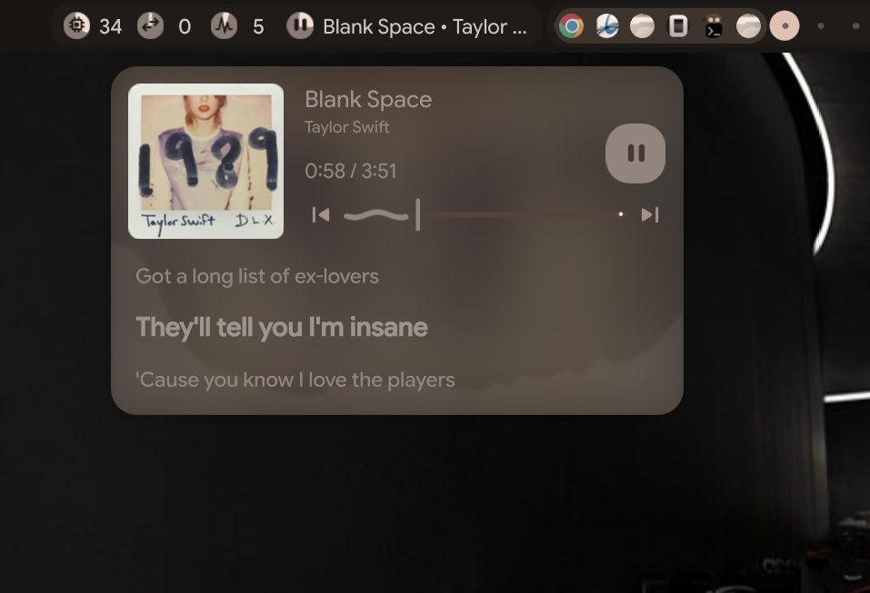

# personal/ — my end-4 / illogical-impulse config

This directory is a **personal overlay on top of `end-4/dots-hyprland`**. It is
kept separate from `dots/` so that pulling upstream changes never conflicts with
my customizations.

The base repo (`setup`, `dots/`, `sdata/`, ...) stays pristine. Everything I
changed lives here.

## Synchronized lyrics

I added synchronized lyrics to the media card. It shows three lines, highlights
the line being sung, and wraps longer lines so they remain readable.



## What is tracked

```
personal/
├── apply.sh                 installs this overlay onto the current machine
├── capture.sh               copies my live config back into this directory
├── files/                   mirrors the paths under $HOME
│   └── .config/
│       ├── illogical-impulse/config.json      wallpaper, clock x/y, bar, theme, ...
│       └── hypr/
│           ├── custom/*.lua                   Hyprland user layer (keybinds, general, ...)
│           ├── hyprlock.conf                  12-hour lock clock
│           └── hyprlock/colors.conf           lock colors (regenerated by matugen)
└── wallpapers/
    ├── .current             name of the active wallpaper
    └── <wallpaper image>
```

`config.json` and `colors.conf` store machine paths as placeholders:

- `@HOME@` → `$HOME`
- `@WALLPAPER@` → the wallpaper path inside the XDG Pictures dir

`apply.sh` fills them in and copies the wallpaper into
`$(xdg-user-dir PICTURES)`.

The Hyprland changes are in `~/.config/hypr/custom/`, which `./setup install`
intentionally never overwrites. The `render_power = 4` fix lives there too, so
the upstream `hyprland/general.lua` can stay untouched.

## Fresh machine

```bash
# 1. install Arch/deps + the base dotfiles
git clone git@github.com:1-4m-5p33d/end4-SPEEED.git
cd end4-SPEEED
./setup install

# 2. log into Hyprland, then apply my overlay
./personal/apply.sh
```

`apply.sh` also runs `switchwall.sh --image <wallpaper>` so matugen regenerates
the whole color scheme (shell, GTK, KDE, fuzzel, lock screen, …).

The media card also shows three lines of synchronized lyrics, with the current
line highlighted. It uses the active player's MPRIS metadata and position and
looks up timed lyrics from LRCLIB, sending the song title and artist to that
service. Tracks without matching timed lyrics show an unavailable message.

## AI image attachments

The overlay adds image attachments to the sidebar's OpenAI-compatible models,
including Token Harbor. PNG, JPEG, GIF, and WebP images are sent as data URLs
with the current message. Reattach an image when a later message needs it.
The installer checks the upstream strategy before applying the hook; reapply
the overlay after upstream updates and restart Quickshell to load the change.

The overlay also enables streamed function calls for OpenAI-compatible models.
Shell commands still require approval in the chat before they run. The model can
read the shell's graphical configuration using its configuration tool.

## Updating from upstream

One-time setup of the upstream remote:

```bash
git remote add upstream https://github.com/end-4/dots-hyprland.git
```

Then, whenever upstream changes:

```bash
git fetch upstream
git merge upstream/main          # or: git rebase upstream/main
./setup install                  # skip rsync steps you don't want
./personal/apply.sh
```

Because this overlay only adds `personal/` (a path upstream never touches),
merges should be conflict-free. `./setup exp-merge` is the repo's experimental
helper for the same idea (it expects an `upstream` remote); it is not required.

The lyrics code lives in `personal/`. Applying the overlay installs its QML and
adds a small hook to the **installed** upstream media card; it does not edit
tracked `dots/` files. Re-run `./personal/apply.sh` after installing upstream
updates. The hook checks the upstream layout before changing it and reports an
error if it no longer matches; in that case the hook in
`personal/install-lyrics-hook.py` needs updating for the new layout. Restart
Quickshell if the card does not reload automatically. A clean Git merge cannot
guarantee compatibility with future upstream shell changes.

## Saving new changes

Change things in the UI as usual, then:

```bash
./personal/capture.sh
git diff -- personal
git add personal && git commit -m "personal: update config"
```

## Intentionally NOT tracked

- **Monitor layout** (`monitors.lua`, `workspaces.conf`) — hardware specific.
  Set it per machine with `nwg-displays` or `hyprctl`.
- **Fonts / fontconfig** — the repo's defaults are kept on purpose. My
  `config.json` already uses the upstream defaults (Google Sans Flex,
  JetBrains Mono NF, Readex Pro, Space Grotesk), and
  `~/.config/fontconfig/fonts.conf` is not carried over.
- **`states.json`** — session state, contains `hyprlandInstanceSignature` and
  overlay positions.
- **Generated/cache data** — `.venv`, `~/.cache`, generated thumbnails, `*.new`
  files created by updates.
- **Unrelated app configs** — Chrome, KDE apps, GIMP, Discord forks, etc. are
  not part of the desktop setup and would rot.

## Notes

- The shell watches `~/.config/illogical-impulse/config.json`, so applying it
  takes effect without restarting Quickshell. A `hyprctl reload` is issued for
  the Hyprland files.
- `capture.sh` writes `@HOME@`/`@WALLPAPER@`; keep using it instead of copying
  `config.json` by hand, or the next machine will get my absolute paths.
- Before making this fork public, skim `files/.config/illogical-impulse/config.json`
  for anything personal (weather city, AI settings). No API keys were found —
  the shell stores key IDs, not secrets — but check the `ai` section anyway.
